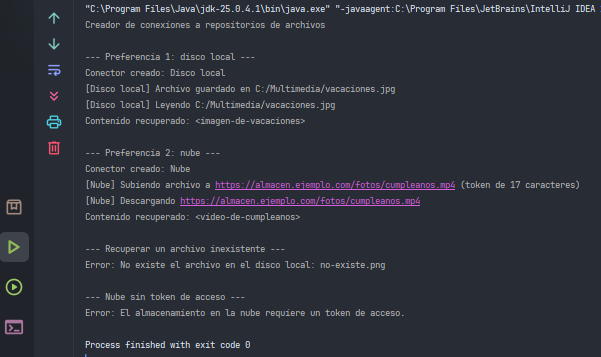

# Ejercicio 02 – Creador de conexiones a repositorios de archivos

## Descripción

Una aplicación de escritorio guarda archivos multimedia en el disco local o en un servidor en la nube, según la preferencia del usuario. Se necesita un punto de creación unificado para los servicios de almacenamiento.

## Objetivos

- Aplicar Factory Method para encapsular la construcción de objetos con la misma interfaz pero comportamientos distintos.
- Separar la lógica que **elige** el creador de la lógica de negocio que **gestiona** los archivos.
- Permitir que cada creador devuelva su conector ya configurado.

## Implementación del patrón Factory Method

| Rol en el patrón | Clase |
|---|---|
| Producto (interfaz) | `FileStorage` |
| Productos concretos | `LocalFileStorage`, `CloudFileStorage` |
| Creador (abstracto) | `StorageCreator` (método de fábrica `createStorage()`) |
| Creadores concretos | `LocalStorageCreator`, `CloudStorageCreator` |
| Selección del creador | `CreatorSelector` + `StorageConfig` + `StoragePreference` |
| Lógica de negocio | `MediaFileManager` |
| Cliente | `Main` |

Cada creador concreto sobrescribe `createStorage()` y devuelve su conector con los datos de configuración (directorio, o URL y token de la nube).

## Propósito de la clase

| Clase | Propósito |
|---|---|
| `FileStorage` | Declara `save()`, `retrieve()` y `getStorageType()`. |
| `LocalFileStorage` | Almacenamiento en disco local (simulado en memoria). |
| `CloudFileStorage` | Almacenamiento en la nube (simulado en memoria). |
| `StorageCreator` | Declara el método de fábrica y `openStorage()`, que crea el conector. |
| `LocalStorageCreator` / `CloudStorageCreator` | Construyen el conector de su tipo. |
| `StorageConfig`, `StoragePreference` | Representan la preferencia elegida por el usuario. |
| `CreatorSelector` | Decide qué creador instanciar y valida que la nube tenga token. |
| `MediaFileManager` | Sube y descarga archivos sin conocer dónde se almacenan. |
| `Main` | Simula ambas preferencias y casos de error. |

## Concepto clave

La decisión de **qué creador usar** vive en `CreatorSelector`, y la de **qué conector construir** vive en cada creador. `MediaFileManager` solo trabaja con `StorageCreator` y `FileStorage`, por lo que no cambia si se agrega un nuevo tipo de almacenamiento.

## Resultado

## Conclusión

Factory Method centraliza la creación de conectores con interfaces similares, y separar la selección de la lógica de negocio hace que el sistema sea fácil de extender (por ejemplo, con un servidor FTP).
